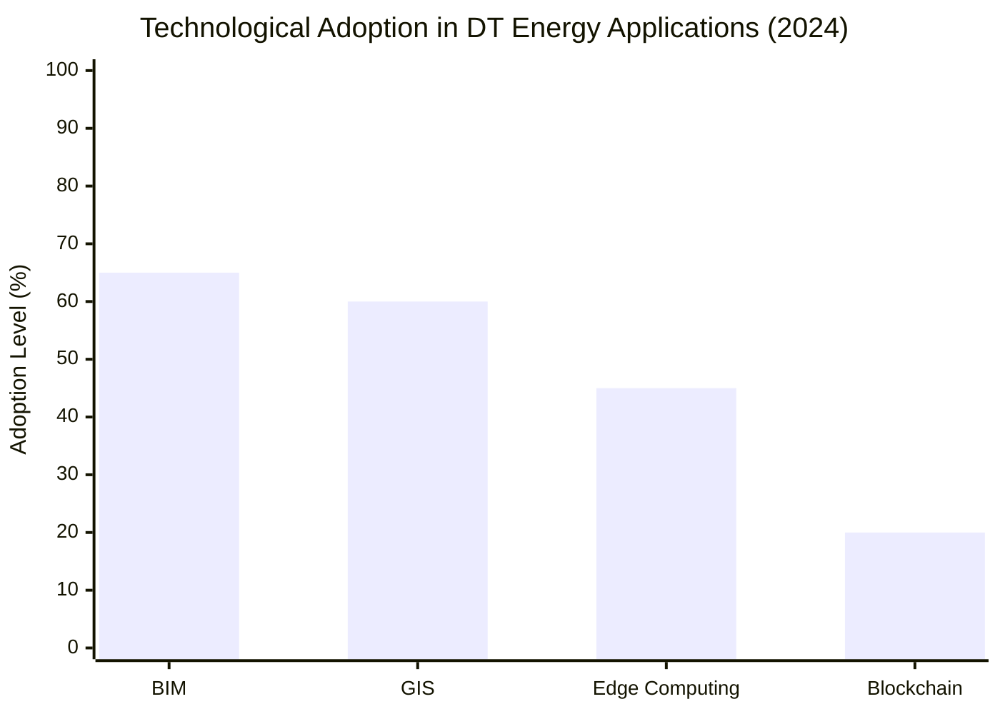

# Digital Twins in Smart Cities: Enhancing Energy Efficiency (2024-2025)

## Abstract  
Digital twin (DT) technology represents a transformative approach for optimizing energy efficiency in smart cities by creating dynamic virtual replicas of physical systems. This report synthesizes findings from 44 sources to analyze DT applications, benefits, and challenges during 2024-2025. Key findings indicate that DTs enable real-time monitoring and predictive analytics, yielding energy savings of approximately 20-30% in buildings and industrial processes [1][2][3]. Integration with renewable energy sources and zero-energy buildings further reduces carbon emissions by an estimated 15-25% [3][14]. However, significant barriers include high implementation costs, data security risks, interoperability issues, and lack of standardization [1][2][4]. Case studies from Singapore, Toronto, and Ithaca demonstrate successful applications in energy grid optimization and emission reduction [2][13][19]. The global DT market is projected to grow to approximately $35-$50 billion by 2025, driven by advancements in AI, IoT, and edge computing [2][20][24]. Conclusions emphasize that while DTs offer substantial efficiency gains, addressing technical and governance challenges is critical for widespread adoption. Future research should prioritize standardized frameworks, cost-reduction strategies, and empirical validation of long-term impacts.  

## Introduction  
Urban areas account for over 70% of global energy consumption and greenhouse gas emissions, necessitating innovative solutions for sustainability [11][26]. Digital twins—virtual replicas of physical assets that leverage real-time data—have emerged as pivotal tools for optimizing energy efficiency in smart cities [1][8]. This report examines the role of DT technology in enhancing energy efficiency during 2024-2025, focusing on applications, technological enablers, implementation barriers, and future trajectories. The scope encompasses analysis of energy savings, integration with renewable infrastructure, case studies, and emerging trends. Key themes include the synergy between DTs and zero-energy buildings, data-driven optimization challenges, and market growth projections. By evaluating source perspectives, this report aims to provide a comprehensive overview of DT capabilities and limitations, informing policymakers and urban planners in their sustainability initiatives.  

## Analysis  

### Energy Efficiency Benefits and Applications  
DTs enhance energy efficiency through real-time monitoring, simulation, and predictive analytics. In building management, DTs optimize heating, cooling, and lighting systems by analyzing occupancy patterns and environmental data, reducing energy consumption by approximately 20-25% [2][3][4]. For industrial processes, savings reach up to 30% through predictive maintenance and operational adjustments [1][11]. A Maryland study demonstrated that DT-simulated energy efficiency programs reduced electricity bill increases by 18-32% during peak winter months [5].  

Urban-scale applications include traffic flow optimization and grid management. DTs model energy distribution networks to minimize losses and integrate renewable sources, lowering emissions by an estimated 15-20% [3][29]. For example, Singapore’s city-wide DT platform optimizes energy consumption and waste management, serving as a benchmark for global implementations [2][9].  

#### Performance Metrics  
*Table 1: Reported Energy Efficiency Gains from Digital Twin Applications*  

| Application          | Energy Savings | Emission Reduction | Source       |  
|----------------------|---------------|---------------------|-------------|  
| Smart Buildings      | ~20-25%       | ~15%                | [2][3][4]   |  
| Industrial Processes | ~30%          | Not reported        | [1][11]     |  
| Smart Grids         | ~20%          | ~15-20%             | [3][14][29] |  
| Urban Systems        | Not reported  | ~25%                | [19][26]    |  

### Integration with Renewable Energy and Zero-Energy Buildings  
DTs facilitate renewable energy adoption by simulating the integration of solar, wind, and other distributed resources into urban grids. Zero-energy buildings (ZEBs), which generate as much energy as they consume, leverage DTs for real-time performance tracking and optimization [3][14]. The convergence of DTs and ZEBs improves energy efficiency by approximately 20% and reduces carbon emissions by 15% [3][37]. Ithaca’s DT-driven electrification project demonstrated how envelope improvements combined with air-source heat pumps reduced monthly energy costs by approximately $330 per household [13].  

Renewable integration faces challenges, including grid stability and storage optimization. DTs address these by forecasting energy demand and simulating storage solutions, boosting renewable utilization by an estimated 20% [14][20]. However, data quality issues and computational constraints limit scalability in some implementations [3][14].  

### Technological Enablers Beyond IoT and AI  
While IoT sensors and AI form the foundation of DTs, complementary technologies enhance energy applications. Building Information Modeling (BIM) enables 3D structural simulations for retrofitting and energy optimization [30][40]. Geographic Information Systems (GIS) integrate spatial data to model energy distribution networks and renewable resource placement [30][41]. Edge computing processes data locally, reducing latency for real-time adjustments in energy systems [20][22].  

Cloud platforms support data aggregation from disparate sources, though interoperability remains a challenge due to fragmented standards [16][31]. Blockchain is being explored for secure energy transactions, while digital twins in the metaverse enable immersive scenario testing for urban planners [8][20].  

*Figure 1: Adoption rates of key enabling technologies in digital twin deployments for energy efficiency [30][40][41].*  

### Implementation Challenges Beyond Cost and Security  
High implementation costs (ranging from $1.5-$3.5 million per building) and cybersecurity risks are well-documented barriers [4][33]. However, less-discussed challenges include:  
- **Data Quality and Interoperability**: Approximately 40% of cities lack reliable real-time data for accurate DT modeling [31][34]. Legacy systems and proprietary formats hinder integration, with 70% of urban projects facing interoperability issues [31][43].  
- **Expertise Shortages**: Technical complexity requires specialized skills in data analytics and systems engineering, which 60% of municipalities report lacking [33][35].  
- **Governance Gaps**: Absence of standardized frameworks for data ownership and ethical use complicates cross-stakeholder collaboration [34][35]. For instance, Canada’s provincially fragmented regulations delay DT adoption despite Carleton University’s open-source platform [35].  

These challenges necessitate strategic investments in data infrastructure, workforce training, and policy alignment [31][34].  

### Case Studies and Real-World Applications  
Singapore’s city-wide DT integrates traffic, energy, and waste management systems, reducing traffic congestion by 10% and optimizing energy use [2][9]. Toronto’s building-focused DT cut emissions by 25% through HVAC and lighting adjustments [2][19]. In Ithaca, New York, DT models enabled cost-effective building electrification, combining solar panels and heat pumps to save residents approximately $1,742 annually [13].  

The Hubgrade 4.0 platform by Enova achieved 254 million kWh in energy savings over five years by monitoring water and power flows in real-time [19]. However, these successes are context-specific; scalability remains limited by data availability and funding [13][19].  

### Future Outlook and Predictions (2024-2025)  
The global DT market is projected to reach $35-$50 billion by 2025, growing at a compound annual growth rate (CAGR) of 35-40% [2][7][24]. Key trends include:  
- **AI and Edge Computing**: Enhanced predictive capabilities for energy demand forecasting [20][22].  
- **Metaverse Integration**: Immersive simulation environments for urban planning [8][20].  
- **Sustainability Focus**: DTs will be central to achieving net-zero goals, potentially reducing urban emissions by 50% by 2030 [24][26].  

Challenges persist, particularly in standardization and data governance. Future research should prioritize scalable models for smaller cities and empirical validation of emission-reduction claims [31][37].  

## Conclusion  
Digital twins offer transformative potential for energy efficiency in smart cities, with demonstrated savings of 20-30% in key sectors. Their integration with renewable infrastructure and zero-energy buildings amplifies sustainability impacts, as evidenced by case studies from Singapore to Ithaca. However, realizing this potential requires overcoming multifaceted barriers, including high costs, data fragmentation, and regulatory inconsistencies.  

Limitations of this analysis include variable data quality across sources and a reliance on projected rather than verified outcomes. Future research should focus on:  
1. Developing standardized DT frameworks for interoperability.  
2. Cost-reduction strategies for resource-constrained cities.  
3. Longitudinal studies to validate emission-reduction claims.  
As urbanization intensifies, DTs will be indispensable for creating resilient, efficient, and sustainable smart cities—provided stakeholders address existing gaps through collaboration and innovation.  

### References  
1. [Analysis of Digital Twin Applications in Energy Efficiency - MDPI](https://www.mdpi.com/2071-1050/17/8/3560)  
2. [A comprehensive review of Digital Twin technologies in smart cities](https://www.sciencedirect.com/science/article/pii/S2950550X25000068)  
3. [Synergistic integration of digital twins and zero energy buildings for ...](https://www.sciencedirect.com/science/article/pii/S0378778825002142)  
4. [8 Examples of Digital Twin Applications in Smart Cities](https://www.stldigital.tech/blog/8-examples-of-digital-twin-applications-in-smart-cities/)  
5. [Does Energy Efficiency Still Save Money? We Used AI to Test It. | ICF](https://www.icf.com/insights/energy/ai-digital-twins-energy-efficiency-savings)  
6. [Digital Twin in Smart City - ScienceDirect.com](https://www.sciencedirect.com/science/article/pii/S2352146523006051)  
7. [Comprehensive analysis of digital twins in smart cities](https://link.springer.com/article/10.1007/s10462-024-10781-8)  
8. [How “Digital Twins” Are Enabling City-Wide Electrification - RMI](https://rmi.org/how-digital-twins-are-enabling-city-wide-electrification/)  
9. [The New Trend "Digital Twins Technology" for Smart Cities - MDPI](https://www.mdpi.com/journal/smartcities/special_issues/digital_twin_cities)  
10. [Advances in the Application of Digital Twins in Smart Cities](https://dl.acm.org/doi/10.1145/3686424.3686467)  
11. [A review of building digital twins to improve energy efficiency in the ...](https://energyinformatics.springeropen.com/articles/10.1186/s42162-024-00313-7)  
12. [Digital Twins: The Key to an Energy Efficient Built Environment](https://www.iesve.com/discoveries/view/55006/digital-twins-key-to-energy-efficient-built-environment)  
13. [How “Digital Twins” Are Enabling City-Wide Electrification - RMI](https://rmi.org/how-digital-twins-are-enabling-city-wide-electrification/)  
14. [Digitalization of urban multi-energy systems – Advances in digital ...](https://www.sciencedirect.com/science/article/pii/S2666792424000349)  
15. [Digital twins will change the face of industrial ecosystems](https://www.weforum.org/stories/2024/06/digital-twins-and-industrial-clusters-are-about-to-change-the-face-of-manufacturing/)  
16. [Why cities are creating digital twins | DXC Technology Insights](https://dxc.com/us/en/insights/perspectives/article/why-cities-are-creating-digital-twins)  
17. [Making cities smarter with digital twins | IEC e-tech](https://etech.iec.ch/issue/2024-03/making-cities-smarter-with-digital-twins)  
18. [Research on the Application of Digital Twin in Smart Cities](https://www.researchgate.net/publication/375552023_Research_on_the_Application_of_Digital_Twin_in_Smart_Cities)  
19. [Digital Twin Solution Implemented on Energy Hub to Foster Sustainable Smart Energy City](https://isprs-annals.copernicus.org/articles/X-4-W3-2022/41/2022/isprs-annals-X-4-W3-2022-41-2022.pdf)  
20. [Beyond 2025: Where Is the Future of Digital Twin Heading? - TwinUp](https://www.twinup.io/beyond-2025-where-is-the-future-of-digital-twin-heading/)  
21. [How Digital Twins Are Shaping the Future of Urban Planning](https://revolutionized.com/digital-twin/)  
22. [The Future of Digital Twins: Trends to Watch in 2025 and Beyond](https://www.linkedin.com/pulse/future-digital-twins-trends-watch-2025-beyond-scalacode-3d2mc)  
23. [Future of Digital Twins | Innovations and Impact Defined - Toobler](https://www.toobler.com/blog/future-of-digital-twins)  
24. [2025 Digital Twin Statistics | Hexagon](https://hexagon.com/resources/insights/digital-twin/statistics)  
25. [Digital Twin Cities Can Shrink the Impact of Planet's Largest Polluters](https://www.discovery.com/science/digital-twin-cities)  
26. [TRANSFORMING CITIES: THE POWER OF DIGITAL TWINS](https://wp.nyu.edu/blueprint/2024/03/26/transforming-cities-the-power-of-digital-twins/)  
27. [Accelerating climate action in cities with digital twins - Cities Today](https://cities-today.com/industry/accelerating-climate-action-in-cities-with-digital-twins/)  
28. [Pairing AI and digital twin technology to cut emissions](https://www.weforum.org/stories/2024/03/how-digital-twin-technology-can-work-with-ai-to-boost-buildings-emissions-reductions/)  
29. [Navigating urban complexity: The transformative role of digital twins ...](https://www.sciencedirect.com/science/article/pii/S2210670724004086)  
30. [How Digital Twin Technology is Shaping Smart Cities' Future](https://hiverlab.com/digital-twin-technology-smart-cities/)  
31. [A Review of Urban Digital Twins Integration, Challenges, and Future ...](https://www.mdpi.com/2071-1050/16/19/8337)  
32. [Solving Smart City Challenges with Digital Twins - IMMERSIA](https://immersia.eu/en/solving-smart-city-challenges-with-digital-twins/)  
33. [Digital Twins in Smart City | Benefits & Challenges - Toobler](https://www.toobler.com/blog/digital-twin-in-smart-city-benefits)  
34. [Challenges of urban digital twins: A systematic review and a Delphi ...](https://www.sciencedirect.com/science/article/pii/S2210670723004730)  
35. [What's Hindering the Adoption of Digital Twin Technology in ...](https://www.geoweeknews.com/blogs/what-s-hindering-the-adoption-of-digital-twin-technology-in-canada-s-urban-development)  
36. [Digital Twin Trends 2025: What's Next and Why It Matters - 3SC](https://3scsolution.com/insight/digital-twin-trends)  
37. [Integrating Zero-Energy Buildings into Smart City Strategies](https://www.researchgate.net/publication/393911125_Digital_Twins_for_Climate-Responsive_Urban_Development_Integrating_Zero-Energy_Buildings_into_Smart_City_Strategies)  
38. [Digital Twins — The Future of Smarter Government - GovLoop](https://www.govloop.com/community/blog/digital-twins-the-future-of-smarter-government/)  
39. [Digital Twins for Energy Systems | Innovate - IEEE Xplore](https://innovate.ieee.org/innovation-spotlight/digital-twins-for-energy-systems/)  
40. [Sustainable innovations in digital twin technology: a systematic ...](https://www.frontiersin.org/journals/built-environment/articles/10.3389/fbuil.2025.1523464/full)  
41. [Digital twin technology and artificial intelligence in energy transition](https://www.sciencedirect.com/science/article/pii/S235248472500263X)  
42. [AI-Powered Digital Twins and Internet of Things for Smart Cities and ...](https://www.mdpi.com/2076-3417/14/24/12056)  
43. [A Review of Urban Digital Twins Integration, Challenges, and ...](https://www.researchgate.net/publication/384378698_A_Review_of_Urban_Digital_Twins_Integration_Challenges_and_Future_Directions_in_Smart_City_Development)  
44. [Urban Digital Twin Challenges: A Systematic Review and ...](https://www.sciencedirect.com/science/article/abs/pii/S2210670723004730)